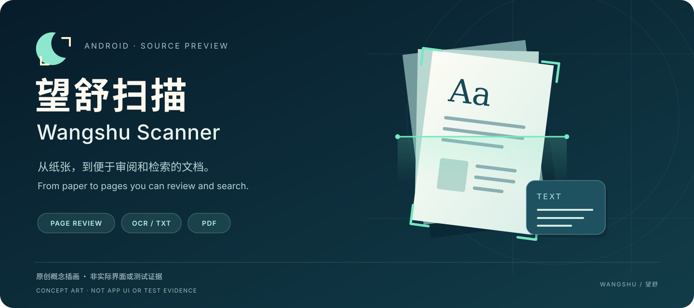

# 望舒扫描 · Wangshu Scanner

**Android 文档扫描开发预览 · Android document-scanning development preview**

[中文](#中文) · [English](#english) · [当前状态 / Status](docs/STATUS.md) · [开发记录 / Development](docs/DEVELOPMENT.md)

## 中文

把纸面资料整理成便于阅读、保存和检索的文档。望舒扫描围绕 Android 上的拍摄／图片导入、页面校正、多页整理和 PDF 导出开发，强调逐页核对与保留原始资料。

### 项目方向

- **整理页面**：自动边界建议与手动四角调整、透视校正，以及彩色／灰度／黑白处理。
- **核对文稿**：调整页序、逐页保存，预览导出的 PDF。
- **审阅文字**：逐页 OCR 纠错、重识别候选对照，以及带页码的 UTF-8 文字副本。这些改进位于[最新源码预览](https://github.com/texasisalwaysbusy/wangshu-scanner/pull/2)，尚未全部通过设备验收。
- **导出 PDF**：普通 PDF 和可搜索 PDF。搜索、选词和复制需使用支持这些功能的外部阅读器；当前应用内预览仅显示页面图像。

**文字纠错与 TXT 导出不会更新 PDF 文字层。** 可搜索 PDF 仍重新 OCR；中文识别较弱，公式识别不可靠，页面边界和文字结果都需要人工核对。

### 当前进度

目前仍是**源码开发预览**，尚无已核实的公开安装包。最近的扫描测试停在准备阶段，修复尚未获得设备验证；诊断构建不能当作已通过验证的 beta。既有检查只覆盖有限场景，全新克隆完整构建也尚未验证。具体版本、已知问题与构建资料见[当前状态](docs/STATUS.md)、[开发记录](docs/DEVELOPMENT.md)及[依赖清单](docs/OCR-DEPENDENCIES.json)。

### 隐私与资料保留

项目以本地处理为方向，但系统文件提供者和分享目标可能连接网络。普通 ZIP **不包含独立编辑恢复记录等资料**，不要把它当作完整备份。清除数据或卸载前，请分别导出并核对需要保留的内容。公开问题请使用合成样本，勿上传私人扫描件、OCR 内容、恢复记录、凭据或私人路径。

## English

Turn paper documents into pages that are easier to review, keep and search. Wangshu Scanner is an Android project for camera capture or image import, page correction, multi-page organization and PDF export, with an emphasis on reviewing each page and preserving source material.

### Project scope

- **Organize pages:** suggested boundaries, manual corner adjustment, perspective correction, and color / grayscale / black-and-white processing.
- **Review documents:** page ordering, per-page saves and an image preview of exported PDFs.
- **Review text:** page-by-page OCR correction, re-recognition candidate comparison and page-numbered UTF-8 text copies. These additions are in the [latest source preview](https://github.com/texasisalwaysbusy/wangshu-scanner/pull/2), with device acceptance still incomplete.
- **Export PDFs:** ordinary and searchable PDFs. Text search, selection and copying require a compatible external reader; the current in-app preview shows page images only.

**Text corrections and TXT exports do not update the PDF text layer.** Searchable PDF generation runs OCR again. Chinese recognition remains weak and formula recognition is unreliable. Review page boundaries and recognized text manually.

### Current status

This is a **source development preview**, with no verified public installable package. The latest scan test stopped during preparation, and a fix has not been validated on a device. Diagnostic builds are not validated betas. Earlier checks cover limited scenarios, and a complete build from a fresh public clone has not been demonstrated. See [Status](docs/STATUS.md), [Development](docs/DEVELOPMENT.md) and the [dependency manifest](docs/OCR-DEPENDENCIES.json).

### Privacy and preservation

The project aims for local processing, but system file providers and sharing destinations may use network services. Ordinary ZIP exports **exclude independent edit-recovery records and other material** and are not complete backups. Export and verify the content you need before clearing data or uninstalling. Use synthetic examples in public issues, not private scans, OCR text, recovery records, credentials or private paths.

## 许可证 · License

原创代码采用 [Apache-2.0](LICENSE)。第三方组件、补丁、字体与模型各自适用独立条款，见 [THIRD_PARTY.md](THIRD_PARTY.md) 及附带 notices。

Original code is licensed under [Apache-2.0](LICENSE). Third-party components, patches, fonts and models retain their own terms; see [THIRD_PARTY.md](THIRD_PARTY.md) and the bundled notices.

*题图为原创概念插画，不是真实界面、私人扫描件或测试结果。The original concept illustration is not an app screenshot, a private scan or test evidence.*
